# Priority Watch

> Independent, verifiable analytics for Arbitrum One's Priority Gas Auction (PGA) ordering policy.


---

## Live

| Resource | URL |
|----------|-----|
| Dashboard | https://priority.watch |
| API base | https://api.priority.watch/api/v1 |
| API reference (Scalar) | https://api.priority.watch/docs |
| OpenAPI spec | https://api.priority.watch/openapi.json |
| Liveness | https://api.priority.watch/healthz |
| Metrics (internal) | https://api.priority.watch/metrics |
| Knowledge base | https://priority.watch/kb |
| dbt docs | https://priority.watch/kb/dbt |

---

## Current data

Data sourced from Arbitrum One via RPC and Binance 1s klines. Updated every 250 ms (live follower).

| Source | Rows (approx) | Latest position |
|--------|---------------|-----------------|
| raw.blocks | ~35 M | head |
| raw.transactions | ~450 M | head |
| raw.receipts | ~450 M | head |
| raw.logs | ~800 M | head |
| raw.cex_klines | ~6 M | head |
| raw.balance_snapshots | ~50 K | hourly |

*As of 2026-10-11. PGA activation: ~2026-09-24. Timeboost baseline: 2025-04-17.*

---

## API

OpenAPI 3.1 spec at `/docs` (Scalar UI) and `/openapi.json`. Rate limit: 60 req/min per IP.

| Group | Prefix | Example |
|-------|--------|---------|
| Blocks | `/api/v1/blocks` | `/api/v1/blocks?range=7d` |
| Health | `/api/v1/blocks/health` | `/api/v1/blocks/health?window=30d` |
| Pricing | `/api/v1/pricing/recommend` | `/api/v1/pricing/recommend?block=0&n=1&confidence=0.8&window=200` |
| Backtest | `/api/v1/backtest` | `POST /api/v1/backtest` |
| Opportunity | `/api/v1/opportunity` | `/api/v1/opportunity/spread/heatmap` |
| Treasury | `/api/v1/treasury` | `/api/v1/treasury?window=30d` |
| Compare | `/api/v1/compare` | `/api/v1/compare?era=both` |
| Datasets | `/api/v1/datasets` | `/api/v1/datasets` |

All Wei values are returned as decimal strings (no floating-point loss). Timestamps are RFC 3339 UTC.

---

## Dashboard

| Route | What it shows |
|-------|--------------|
| `/blocks` | Per-block PGA metrics, fee distributions, payer leaderboard, real-time mode |
| `/health` | System health, base-fee trends, HHI, treasury accounting, era comparison |
| `/pricing` | Fee model recommendations with reasoning trace, parameter sliders, backtested eval |
| `/opportunity` | CEX-DEX spread heatmap, markout scatter, entity position leaderboard, capture rate |
| `/simulator` | Strategy backtester: up to 4 parallel runs, cumulative P&L curve |

---

## Ingester schedule

| Job | Cadence | Notes |
|-----|---------|-------|
| Chain blocks, txs, receipts, logs | Continuous per block (~250 ms) | Go follower service |
| Binance 1s klines forward-fill | Continuous WebSocket | Go follower service |
| Fee-recipient balance snapshots | Every hour | Go follower service |
| dbt incremental models | Every 10 min | Airflow |
| Monitoring (lag, gaps, freshness) | Every 5 min | Airflow |
| Binance daily catch-up | Daily 01:00 UTC | Airflow |
| dbt full tests + docs + backup | Nightly 02:00 UTC | Airflow |
| Timeboost baseline import | Manual | Airflow |

---

## Run locally

```bash
# 1. Clone and configure
git clone https://github.com/uwezukwechibuzor/priority-watch.git
cd priority-watch
cp .env.example .env          # fill in ARBITRUM_RPC_URL and ARBITRUM_WS_URL

# 2. One-time setup (install hooks and Go tools)
make setup

# 3. Start the stack (ClickHouse, Postgres, Airflow)
make up

# 4. Run ClickHouse migrations
make migrate

# 5. Backfill the last 14 days
make backfill FROM=$(PGA_ACTIVATION_BLOCK) TO=head

# 6. Start the frontend dev server and API
make web-dev &
# pw-api is started as a Docker profile: docker compose --profile api up -d

# 7. (Optional) Start observability stack
make up-obs
```

Requirements: Docker 25+, Docker Compose v2, Go 1.26+, Node 22+, pnpm 10+.

---

## Architecture

```mermaid
flowchart TD
    %% ── External data sources ──────────────────────────────────────────
    subgraph SOURCES["External Sources"]
        ARB["Arbitrum One\nJSON-RPC / WebSocket"]
        SQD["SQD Portal\n(primary block stream)"]
        HYP["Envio HyperSync\n(fallback stream)"]
        BIN["Binance WebSocket\n(1s klines)"]
        TB["Timeboost baseline\n(Parquet import)"]
    end

    %% ── Go ingester binary ──────────────────────────────────────────────
    subgraph INGESTER["cmd/pw-ingester  (Go binary)"]
        direction TB
        BF["backfill\nhistorical range"]
        FW["follow\nlive per-block"]
        CEX["cex\nklines forward-fill"]
        ITB["import-timeboost\nbaseline loader"]
        MIG["migrate\nClickHouse DDL"]
    end

    %% ── internal Go packages ────────────────────────────────────────────
    subgraph INTERNAL["internal/  (shared Go packages)"]
        direction LR
        CFG["config\nenv-var loader"]
        OBS["obs\nslog · Prometheus\n/healthz · /metrics"]
        CHN["chain\nBlockSource interface\nRPCBlockSource\nSQDBlockSource\nHyperSyncSource\nFailoverBlockSource"]
        STR["store\nClickHouse writer\nmigrations\nmeta cursors"]
        ING["ingest\nblock backfill\nlive follower\nreorg handling"]
        CEXP["cex\nBinance REST+WS\ndaily catch-up"]
        MDL["models\nfee pricing models\nbacktest engine"]
        API_PKG["api\nHTTP handlers\nOpenAPI · caching\nrate limits"]
    end

    %% ── config/ reference data ─────────────────────────────────────────
    subgraph CONFIG["config/  (reference YAML)"]
        ENT["entities.yaml\naddress labels"]
        POOLS["pools.yaml\nDEX pool addresses"]
        CTR["contracts.yaml\nverified contracts"]
        EVT["events.yaml\non-chain events"]
    end

    %% ── ClickHouse (raw + meta) ─────────────────────────────────────────
    subgraph CH["ClickHouse  (primary store)"]
        direction TB
        RAW["raw.*\nblocks · transactions\nreceipts · logs\ncex_klines · reorg_log"]
        META["meta.*\ningest_cursors · source_status\nschema_migrations\nentities · pools · contracts"]
    end

    %% ── dbt transformation pipeline ─────────────────────────────────────
    subgraph DBT["dbt/  (transformation pipeline)"]
        direction TB
        SEEDS["seeds/\nentities · pools\ncontracts · events\nbenchmarks"]
        STG["staging/*\nstg_blocks · stg_transactions\nstg_receipts · stg_logs\nstg_cex_klines · stg_dex_swaps\nstg_erc20_transfers · stg_timeboost_*\nstg_balance_snapshots · stg_aave_liquidations"]
        INT["intermediate/*\nint_tx_fees · int_block_ordering\nint_entities · int_tx_classification\nint_dex_price_per_block · int_cex_mid_at_block\nint_timeboost_rounds · int_spam_signals"]
        MRT["marts/*\nfct_blocks · fct_transactions\nfct_treasury_daily · fct_swap_markouts\nfct_spread_per_block · fct_arb_capture\nfct_base_fee_changes · fct_execution_quality_daily\nagg_blocks_hourly · agg_blocks_minutely\nagg_payer_share_daily · agg_spread_heatmap\nagg_spread_histogram · agg_base_fee_hourly\nagg_health_daily · agg_era_comparison\nagg_entity_position_daily · agg_tipped_tx_hist_daily\ndim_entities · dim_events"]
        MACRO["macros/\nhex_conversions\nunit_conversions\ngenerate_schema_name"]
    end

    %% ── Airflow orchestration ────────────────────────────────────────────
    subgraph AF["airflow/  (orchestration)"]
        direction LR
        DAG1["pw_dbt_incremental\nevery 10 min"]
        DAG2["pw_dbt_nightly\n02:00 UTC"]
        DAG3["pw_monitoring\nevery 5 min"]
        DAG4["pw_cex_daily\n01:00 UTC"]
        DAG5["pw_backfill\nmanual"]
        DAG6["pw_clickhouse_backup\n03:00 UTC"]
        DAG7["pw_timeboost_baseline\nmanual"]
    end

    %% ── API binary ───────────────────────────────────────────────────────
    subgraph APIB["cmd/pw-api  (Go binary)"]
        direction TB
        APIRT["/api/v1/blocks\n/api/v1/pricing\n/api/v1/opportunity\n/api/v1/treasury\n/api/v1/compare\n/api/v1/datasets\n/api/v1/backtest\n/healthz · /metrics\n/docs  (Scalar UI)"]
    end

    %% ── Frontend ─────────────────────────────────────────────────────────
    subgraph WEB["apps/web/  (Vite + React 19)"]
        direction LR
        R1["/blocks\nblock table · KPI cards\npayer leaderboard"]
        R2["/health\nbase-fee trends · HHI\ntreasury accounting"]
        R3["/pricing\nfee model · sliders\nbacktest eval"]
        R4["/opportunity\nspread heatmap\nmarkout scatter"]
        R5["/simulator\nstrategy backtester\nP&L curve"]
    end

    %% ── Infra & observability ────────────────────────────────────────────
    subgraph INFRA["infra/  (infrastructure)"]
        direction LR
        CADDY["caddy/\nTLS reverse proxy\nLet's Encrypt"]
        PROM["prometheus/\nscrape config\n(api · follower · clickhouse)"]
        GRAF["grafana/\ndashboards\nprovisioning"]
        CHMIG["clickhouse/\nconfig.d · users.d\nmigrations/"]
    end

    %% ── CI / hooks ───────────────────────────────────────────────────────
    subgraph CICD[".github/ + .githooks/"]
        CI["ci.yml\nbuild · lint · test\nauthor-check"]
        REL["release.yml\nGHCR image push"]
        HOOKS["pre-commit · commit-msg\npre-push"]
    end

    %% ── Data flow edges ──────────────────────────────────────────────────
    SQD --> CHN
    HYP --> CHN
    ARB --> CHN
    BIN --> CEXP
    TB  --> ITB

    CHN --> ING
    ING --> STR
    STR --> RAW
    CEXP --> RAW
    ITB --> RAW
    MIG --> META

    CFG --> ING
    CFG --> CEXP
    CONFIG --> SEEDS
    SEEDS --> META

    RAW --> STG
    META --> STG
    STG --> INT
    MACRO --> STG
    MACRO --> INT
    INT --> MRT

    DAG1 -->|"dbt run staging+intermediate+marts"| STG
    DAG2 -->|"dbt test + docs + full refresh"| MRT
    DAG3 -->|"healthz · lag · gap checks"| META
    DAG4 -->|"Binance catch-up"| RAW
    DAG5 -->|"backfill range"| BF
    DAG6 -->|"BACKUP DATABASE"| CH
    DAG7 -->|"import Timeboost baseline"| ITB

    MRT --> APIRT
    MDL --> APIRT
    API_PKG --> APIRT

    APIRT --> R1
    APIRT --> R2
    APIRT --> R3
    APIRT --> R4
    APIRT --> R5

    CADDY -->|"TLS termination"| APIRT
    CADDY -->|"TLS termination"| WEB
    PROM -->|"scrape /metrics"| APIRT
    PROM --> GRAF
    OBS --> APIRT

    CICD -->|"validate every push"| INGESTER
    CICD -->|"validate every push"| APIB
```



---

## Workspace layout

| Path | Description |
|------|-------------|
| `cmd/pw-ingester/` | Ingester binary (migrate, backfill, follow, cex) |
| `cmd/pw-api/` | REST API binary (chi + huma v2) |
| `internal/` | Shared Go packages (config, obs, chain, store, ingest, cex, api, models) |
| `apps/web/` | Vite 6 + React 19 + Tailwind v4 frontend |
| `dbt/` | dbt-core models (staging → intermediate → marts) |
| `airflow/` | Airflow DAGs + Astronomer Cosmos |
| `infra/` | ClickHouse config, Caddy, Prometheus, Grafana |
| `docs/` | MkDocs Material knowledge base |
| `tests/` | Integration tests (testcontainers-go), k6 load tests |
| `config/` | Entity labels, DEX pools, contract addresses, events |

---

## Stack

| Layer | Technology |
|-------|-----------|
| Chain data | go-ethereum, Arbitrum One JSON-RPC / WebSocket |
| Storage | ClickHouse 25.x (raw + meta + staging + intermediate + marts) |
| Orchestration | Apache Airflow 2.x + Astronomer Cosmos |
| Transformation | dbt-core + dbt-clickhouse |
| API | Go 1.26, chi, huma v2, OpenAPI 3.1 |
| Frontend | Vite 6, React 19, TypeScript strict, Tailwind v4, TanStack Router/Query, ECharts |
| Observability | Prometheus, Grafana, slog JSON |
| Reverse proxy | Caddy 2 (automatic TLS via Let's Encrypt) |
| CI/CD | GitHub Actions, GHCR |

---

## License

MIT — see [LICENSE](LICENSE).
